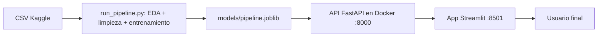

# Proyecto Final MLOps: ¿Cuánto vale mi coche usado? (CarDekho)

**Autor:** Carlos · **Curso:** 2026, Immune Technology Institute, Práctica Final MLOps

Una persona normal introduce los datos de su coche en una web (Streamlit) y recibe un precio estimado de reventa.
La web llama a una API (FastAPI, en Docker) que sirve un modelo entrenado sobre el dataset CarDekho.



---

## 1. Elección del dataset (M1.1)

* **Ruta elegida:** Opción A, dataset de la casa **Vehicle Dataset from CarDekho**
  ([Kaggle](https://www.kaggle.com/datasets/nehalbirla/vehicle-dataset-from-cardekho)), con su problema natural asumido:
  **regresión del precio de reventa**. Sabemos que con esta ruta M1 queda topado a 16/20.
* **Fichero usado:** `CAR DETAILS FROM CAR DEKHO.csv` (4.340 filas × 8 columnas), uno de los ficheros incluidos en ese dataset de Kaggle.
  Lo elegimos porque sus columnas (marca/modelo, año, km, combustible, vendedor, transmisión, propietarios)
  son datos que **cualquier usuario conoce de su coche**, y eso hace posible la mini-app de M4.
  Los ficheros con más columnas (mileage, engine, max_power, torque) piden datos técnicos que un usuario normal no sabe.
* **Target:** `selling_price` (rupias indias, INR).
* **Diccionario de columnas:**

| Columna | Tipo | Descripción |
| :--- | :--- | :--- |
| `name` | texto | Marca + modelo + versión (p. ej. "Maruti Swift Dzire VDI") |
| `year` | entero | Año de matriculación |
| `selling_price` | entero | **Target**: precio de venta (INR) |
| `km_driven` | entero | Kilómetros recorridos |
| `fuel` | categoría | Petrol, Diesel, CNG, LPG, Electric |
| `seller_type` | categoría | Individual, Dealer, Trustmark Dealer |
| `transmission` | categoría | Manual, Automatic |
| `owner` | categoría | First Owner, Second Owner, ..., Test Drive Car |

---

## 2. Estructura del repositorio

```text
├── .github/workflows/
│   ├── ci.yml                   # CI: flake8 + pytest en cada push / PR
│   ├── retrain.yml              # Reentrenamiento semanal + drift + puerta de métrica
│   └── release.yml              # CD con tag: imagen a GHCR + GitHub Release
├── scripts/
│   ├── metric_gate.py           # Puerta de métrica para promover modelos
│   └── drift_check.py           # Detección de drift (KS + chi²)
├── data/raw/                    # CSV original
├── data/processed/              # CSV limpio + train/val/test
├── notebooks/
│   ├── 01_eda_and_audit.ipynb   # Auditoría + EDA explicada
│   └── 02_model_evaluation.ipynb# Modelos, baseline y evaluación explicados
├── reports/figures/             # Todas las gráficas (EDA, decisiones, modelo)
├── src/
│   ├── download_data.py         # Descarga el CSV
│   ├── eda_audit.py             # Auditoría impresa + gráficas EDA
│   ├── data_prep.py             # 5 decisiones de preparación + splits
│   ├── train.py                 # Entrena, compara con dummy, evalúa y exporta el modelo
│   ├── api.py                   # API FastAPI (/health, /predict, /docs)
│   └── app.py                   # Mini-app Streamlit (consume la API)
├── tests/test_api.py            # Smoke tests de la API
├── models/pipeline.joblib       # Artefacto único: preprocesado + modelo
├── models/metrics.json          # Métricas del modelo servido (las usa /version)
├── CHANGELOG.md                 # Cambios por versión (va en la GitHub Release)
├── run_pipeline.py              # Todo el procesado en un solo comando
├── Dockerfile                   # Imagen de la API
├── requirements.txt             # Dependencias fijadas (==)
└── requirements-api.txt         # Dependencias mínimas de la imagen Docker
```

---

## 3. Cómo ejecutarlo (demo en 2 minutos)

**Requisitos:** Python 3.13 y Docker Desktop.

```bash
# 0) Instalar dependencias (solo la primera vez)
pip install -r requirements.txt

# 1) (Opcional) Regenerar todo: descarga + EDA + limpieza + entrenamiento
python run_pipeline.py

# 2) Arrancar la API en Docker
docker build -t cardekho-api .
docker run -d --name cardekho-api -p 8000:8000 cardekho-api

# 3) Arrancar la app para el usuario
streamlit run src/app.py
```

* App de usuario: <http://localhost:8501>
* Swagger de la API: <http://localhost:8000/docs>
* Health check: <http://localhost:8000/health>
* Versión y métricas del modelo: <http://localhost:8000/version>

Sin Docker, la API también arranca con: `uvicorn src.api:app --port 8000`

**Tests y linter (lo mismo que ejecuta el CI):**
```bash
flake8 src tests scripts run_pipeline.py
pytest -v
```

---

## 4. Módulo 1: Auditoría y Decisiones de Preparación de Datos

### Auditoría Inicial (Datos Crudos):
* **Registros:** 4,340 filas × 8 columnas.
* **Valores nulos:** 0 nulos detectados.
* **Duplicados:** 763 registros repetidos (17.58%).
* **Target (`selling_price`):** Min: 20,000 | Mediana: 350,000 | Media: 504,127 | Max: 8,900,000. Alta asimetría positiva hacia la derecha.

### Las 5 Decisiones de Preparación Justificadas (M1.4):
1. **Decisión 1 (Drop - Eliminación de Duplicados):**
   - *Motivo:* 763 registros eran réplicas exactas. Mantenerlos provocaría sobreajuste y fuga de datos (data leakage) entre train y test.
   - *Resultado:* Reducción de 4,340 a 3,577 registros únicos.
   - *Gráfico:* `reports/figures/decision_1_drop_duplicates.png`.
2. **Decisión 2 (Crear - Extracción de la Marca `brand` y Modelo `car_model`):**
   - *Motivo:* El campo `name` contenía 1,491 nombres completos con excesiva cardinalidad. Extrayendo la primera palabra obtenemos 29 marcas principales y con la segunda palabra 183 modelos (`Swift`, `City`, `i20`, etc.), preservando la señal del fabricante y gama sin ruido de versiones menores.
   - *Resultado:* Nuevas columnas categóricas `brand` y `car_model` (Top 5 marcas: Maruti, Hyundai, Mahindra, Tata, Ford).
   - *Gráfico:* `reports/figures/decision_2_create_brand.png`.
3. **Decisión 3 (Crear/Transformar - Antigüedad `vehicle_age`):**
   - *Motivo:* El año calendario `year` es menos informativo que la antigüedad del coche en años (`2020 - year`), la cual correlaciona directamente con la depreciación acumulada del vehículo.
   - *Resultado:* Variable continua `vehicle_age` entre 0 y 28 años.
   - *Gráfico:* `reports/figures/decision_3_vehicle_age.png`.
4. **Decisión 4 (Filtro/Drop - Tratamiento de Outliers en `km_driven`):**
   - *Motivo:* Existen vehículos con kilometrajes poco creíbles (>800,000 km) o cercanos a cero (1 km). Se filtran valores atípicos superiores al percentil 99.5 (~250,720 km) e inferiores a 500 km.
   - *Resultado:* 22 registros anómalos eliminados, estabilizando la distribución a 3,555 instancias fiables.
   - *Gráfico:* `reports/figures/decision_4_filter_outliers.png`.
5. **Decisión 5 (Recodificar - Orden de `owner` y Binaria para `transmission`):**
   - *Motivo:* `owner` es de naturaleza ordinal por número de propietarios anteriores. Se recodifica numéricamente de 0 a 4 (0: Test Drive Car, 1: First Owner, 2: Second Owner, 3: Third Owner, 4: Fourth+ Owner). `transmission` se codifica a binario (0: Manual, 1: Automatic).
   - *Resultado:* Variables numéricas listas para regresores manteniendo coherencia semántica.
   - *Gráfico:* `reports/figures/decision_5_recodification.png`.

---

## 5. Módulo 2: Modelo, Baseline y Evaluación

### 1. Justificación Problema → Tarea → Métrica (M2.1):
* **Problema:** Valoración del precio de mercado de vehículos de segunda mano.
* **Tarea:** Regresión supervisada sobre `selling_price`.
* **Métrica principal (MAE):** Error Absoluto Medio expresado directamente en la moneda del problema (rupias indias). Permite a compradores y vendedores entender intuitivamente la desviación esperada.
* **Métricas secundarias:** RMSE (penaliza desviaciones extremas) y R² (% varianza explicada).

### 2. Baseline Dummy vs Modelo Final (M2.2):
Se implementó un `DummyRegressor(strategy='mean')` como línea base mínima ("no hacer nada"):

| Modelo | Val MAE (₹) | Val RMSE (₹) | Val R² | Supera al Dummy |
| :--- | :---: | :---: | :---: | :---: |
| **Dummy (Media)** | 292,053 | 471,951 | -0.0005 | *Línea Base* |
| **Ridge Regressor** | 121,759 | 249,660 | 0.7200 | Sí (-58.3% MAE) |
| **Random Forest (Campeón)** | **119,437** | **289,737** | **0.6229** | **Sí (-59.1% MAE)** |
| **Gradient Boosting** | 130,081 | 234,719 | 0.7525 | Sí (-55.5% MAE) |

> El modelo final (**Random Forest**, elegido por menor MAE en Validación) reduce el error del Dummy en un **-59.1%**.

### 3. Split Correcto sin Fugas (M2.3):
* Partición: **Train (70% - 2,487 filas)**, **Validation (15% - 534 filas)** y **Test (15% - 534 filas)**.
* Sin fugas: Los transformadores (`StandardScaler`, `OneHotEncoder`) se ajustan únicamente sobre Train.
* La selección del modelo campeón se realizó comparando en Validación, manteniendo el Test completamente sellado.
* **Resultados finales en TEST SET (Sellado):**
  - **Test MAE:** 117,717 ₹ (~1,308 €)
  - **Test RMSE:** 273,935 ₹
  - **Test R²:** 0.7113

### 4. Técnicas y Resultados Visuales (M2.4):
* `reports/figures/model_comparison.png`: Comparativa de MAE entre familias de modelos y baseline.
* `reports/figures/residuals_plot.png`: Gráfico de residuales vs predichos sin patrones anómalos.
* `reports/figures/predictions_vs_actual.png`: Comparación visual predicción vs realidad con línea ideal 1:1.
* `reports/figures/residuals_distribution.png`: Campana de distribución de errores residuales centrada en 0.

### 5. Reproducibilidad y Empaquetado (M2.5 y M3.2):
* Semillas fijas: `random_state=42` en splits, preprocesadores y regresores.
* Dependencias fijadas en `requirements.txt`.
* Artefacto unificado guardado en `models/pipeline.joblib` (preprocesado + modelo en un solo paso).

> **Nota sobre las variables creadas en las decisiones 3 y 5:** `vehicle_age`, `owner_num` y `transmission_num` se dejan en
> `car_details_cleaned.csv` como análisis, pero el modelo usa las columnas originales `year`, `owner` y `transmission`.
> Motivo: así la API recibe exactamente lo que el usuario sabe de su coche y **todo** el preprocesado
> (escalado + One-Hot) vive dentro de `pipeline.joblib`. `vehicle_age` es solo `2020 - year`, así que no aporta información nueva al modelo,
> y el One-Hot de `owner` y `transmission` recoge la misma señal que su recodificación numérica.

---

## 6. Módulo 3: Despliegue (API + Docker)

| Mínimo | Cómo se cumple |
| :--- | :--- |
| API con `/predict` y `/health` | [src/api.py](src/api.py) con FastAPI (también `/` con listado de endpoints) |
| Pipeline empaquetado entero | `models/pipeline.joblib` = `ColumnTransformer` (StandardScaler + OneHotEncoder) + `RandomForestRegressor`. El cliente manda datos en crudo; la API convierte el precio a EUR (`1 EUR = 90 INR`) |
| Esquema documentado (Swagger) | Modelos Pydantic `CarInput` / `PredictionOutput`, servidos en `/docs` |
| Imagen Docker que arranca en local | [Dockerfile](Dockerfile) (`python:3.13-slim`, solo las dependencias de `requirements-api.txt`) |
| Validación y errores controlados | Ver tabla de abajo |

**Ejemplo de petición:**
```bash
curl -X POST http://localhost:8000/predict -H "Content-Type: application/json" \
  -d '{"brand":"Maruti","car_model":"Swift","year":2015,"km_driven":50000,"fuel":"Petrol","seller_type":"Individual","transmission":"Manual","owner":"First Owner"}'
# -> {"predicted_price": ..., "currency": "EUR", "predicted_price_inr": ...}
```

**Errores controlados:**

| Caso | Respuesta |
| :--- | :--- |
| Campo que falta, tipo incorrecto | `422` con el detalle del campo |
| `km_driven` fuera de [500, 300000], `year` fuera de [1990, 2020] | `422` (rango visto en entrenamiento: no extrapolamos) |
| Categoría desconocida (p. ej. `fuel: "Gasolina"`, marca no vista) | `422` con la lista de valores válidos |
| Modelo no cargado | `503` |
| Fallo inesperado al predecir | `500` con mensaje |
| Predicción negativa | Se acota al mínimo del dataset (20.000 INR) |

---

## 7. Módulo 4: App de usuario (Streamlit)

| Mínimo | Cómo se cumple |
| :--- | :--- |
| Uso sin terminal ni Python | Formulario web con desplegables dependientes (`Marca` → `Modelo` desde `models/brand_models.json`) y sliders → botón "Calcular precio" → precio en euros (`€`) + aviso del error medio (~1.308 €) |
| Consume la API de M3 | [src/app.py](src/app.py) hace `POST /predict` con `requests`. No carga el modelo. La URL se configura vía `st.secrets["API_URL"]` o variable de entorno `API_URL` |
| Funcionando al evaluar | Demo local guiada (sección 3) |
| Estados de espera y error | Al abrir la app: banner verde/rojo según `/health`. Al predecir: spinner "Calculando precio...". Errores: API caída, 422 o 5xx muestran un mensaje claro |

---

## 8. Módulo 5: Automatización

| Mínimo | Cómo se cumple |
| :--- | :--- |
| CI: linter + tests en cada PR | [.github/workflows/ci.yml](.github/workflows/ci.yml): en cada `push` y `pull_request` a `main` ejecuta `flake8` y `pytest` (10 smoke tests de la API: raíz, health, version, predicción EUR, límite de año, km negativos, combustible inválido, campo que falta y Swagger) |
| Procesado de un solo comando | `python run_pipeline.py`: descarga → auditoría/EDA → 5 decisiones + splits → entrenamiento → `models/pipeline.joblib`. Reproducible: con seed 42 da siempre las mismas métricas |

---

## 9. Extras (secundarios)

| Módulo | Extra | Cómo comprobarlo |
| :--- | :--- | :--- |
| M2 | Comparación de 3 familias de modelo (Ridge, Random Forest, Gradient Boosting) | Sección 5 y `reports/figures/model_comparison.png` |
| M3 | Endpoint de versión: `/version` devuelve la versión de la API y las métricas del modelo servido | <http://localhost:8000/version> |
| M3 | Multi-stage build: la etapa 1 instala dependencias y la imagen final solo copia los paquetes | [Dockerfile](Dockerfile) |
| M3 | Hardening: el contenedor corre con el usuario `appuser`, no como root | `docker exec cardekho-api whoami` → `appuser` |
| M5 | Reentrenamiento programado con puerta de métrica: cada lunes (o a mano desde Actions) reentrena y solo hace commit del modelo si **gana al dummy** y **mejora el MAE del modelo actual** | [retrain.yml](.github/workflows/retrain.yml), [metric_gate.py](scripts/metric_gate.py) |
| M5 | Detección de drift: test KS (numéricas) y chi² (categóricas) con p < 0,05. Guarda un informe en `reports/drift_report.json`. Se ejecuta en el reentrenamiento | `python scripts/drift_check.py` (sin drift) y `python scripts/drift_check.py --simulate` (detecta el drift simulado) |
| M5 | CD con tag: tests → imagen en `ghcr.io/carlostq06/mlops-api` → GitHub Release con el changelog | [release.yml](.github/workflows/release.yml), [CHANGELOG.md](CHANGELOG.md) |

**Cómo sacar una versión nueva:**
```bash
git tag v1.0.1
git push origin v1.0.1
```

**Por qué la puerta usa "gana al dummy y mejora al actual":** un reentrenamiento automático nunca debe empeorar lo que está en producción.
Si el modelo nuevo es igual o peor, se descarta y la API sigue sirviendo el anterior. Si ni siquiera gana al dummy, el job falla para avisar.
